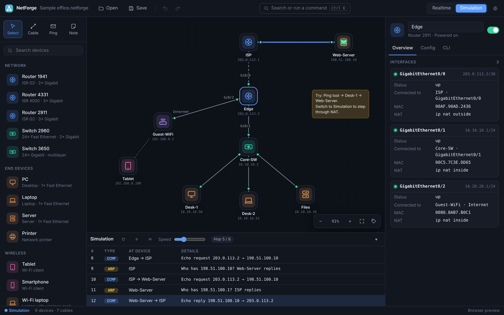

# NetForge

A modern, fast network simulator for the desktop that **opens Cisco Packet Tracer `.pkt` labs**.
Built with Tauri (Rust) and React. Runs on Linux, Windows and macOS.



## Why

Packet Tracer works, but it feels like 2002. NetForge keeps the parts that matter for learning
networking (dragging devices around, cabling them, the IOS CLI, stepping packets through
simulation mode) and wraps them in an interface that feels like a current app:

- **Dark and light themes**, a clean device library, and a canvas that pans and zooms smoothly
- **Command palette** (`Ctrl K`) for every action, device and quick ping
- **Undo / redo** for everything, including CLI changes
- **Inspector panel** instead of modal windows: Overview, Config and CLI tabs right beside the topology
- **Live link lights** (green = up, red = down / shutdown) and toggleable port labels
- **Simulation mode** with play, pause, step and speed controls and an ARP / NAT / ICMP event table

## What it simulates

| Area | Supported |
| --- | --- |
| Devices | Routers (1941, 2911, 4331, incl. EHWIC switch ports), switches (2960, 3650, Switch-PT), PCs, laptops, servers, printers, tablets, phones, access points, Linksys-style home Wi-Fi routers. Cell towers and central office servers are shown but not simulated |
| Layer 2 | Cables, switching / bridging, Wi-Fi association by SSID and range |
| Layer 3 | Static IPs, default gateways, connected and static routes (longest-prefix match), switch SVIs |
| Services | DHCP (IOS pools, excluded addresses, home-router DHCP, Server-PT DHCP service, `ip helper-address` relay), NAT overload (IOS `ip nat inside/outside`, home routers) |
| IOS CLI | `enable`, `configure terminal`, `interface` (incl. `range`), `ip address`, `shutdown`, `hostname`, `ip route`, `ip dhcp pool`, `ip nat`, `show running-config`, `show ip interface brief`, `show ip route`, `show interfaces`, `show ip dhcp binding`, `show vlan brief`, `ping`, `traceroute`, `do`, `copy run start`… with abbreviations (`conf t`, `int g0/0`, `sh ip int br`), Tab completion, `?` and history |
| Host prompt | `ipconfig [/all /renew /release]`, `ping [-n]`, `tracert` |

Not yet: VLAN trunking, dynamic routing protocols (RIP/OSPF/EIGRP commands are accepted and saved but not run), ACL enforcement, IPv6, and servers' HTTP/DNS/email services.

## Activities (.pka)

Opening a `.pka` loads your working network (never the answer network inside the file) and shows
the activity's **instructions**. **Check results** scores the assessment items NetForge can
evaluate (IP settings, gateways, DNS, cabling, SSIDs, home-router DHCP, device models) and lists each
item as correct, incorrect or not checked, without revealing expected values. Items Packet Tracer grades
through activity variables, DHCP-assigned addresses and cable-type codes are listed as not checked.
It's an estimate: Packet Tracer's own Check Results is what counts for coursework. Saving back to
`.pka` only changes your working network.

## Packet Tracer files

NetForge opens `.pkt` and `.pka` files from Packet Tracer 5.0 and later (tested with 8.1, 8.2 and 9.0).
Device positions, names, interfaces, IP settings, IOS running-configs, home-router settings and
cables are imported. Anything NetForge doesn't model is preserved untouched.

**Export .pkt** writes your changes back into the original file: names, positions, IP settings,
running and startup configs, home-router settings and cables. Devices you *added* in NetForge
can't be written into a Packet Tracer file yet. Save as `.netforge` to keep everything.

The file format is documented in [docs/PKT_FORMAT.md](docs/PKT_FORMAT.md). It was implemented
clean-room for interoperability, from the publicly documented research in
[pka2xml](https://github.com/mircodz/pka2xml) (BSD-2-Clause). No Cisco code or binaries were
decompiled or used. The codec is its own crate in [`crates/pktcodec`](crates/pktcodec) with a
small CLI:

```sh
cargo run --manifest-path crates/pktcodec/Cargo.toml --bin pktconv -- decode lab.pkt lab.xml
cargo run --manifest-path crates/pktcodec/Cargo.toml --bin pktconv -- encode lab.xml lab.pkt
```

## Install

Grab an installer from the [Releases](../../releases) page (`.deb` / AppImage for Linux, `.msi` / `.exe` for
Windows, `.dmg` for macOS). Releases are built by GitHub Actions when a `v*` tag is pushed.

## Build from source

Requirements: Node 20+, Rust (stable), and the Tauri system libraries.

On Ubuntu / Kubuntu / Debian:

```sh
sudo apt install libwebkit2gtk-4.1-dev libgtk-3-dev libayatana-appindicator3-dev librsvg2-dev libxdo-dev libssl-dev build-essential file
```

Then:

```sh
npm install
npm run tauri dev       # run with hot reload
npm run tauri build     # build installers into src-tauri/target/release/bundle
```

`npm run dev` runs the UI alone in a browser for quick UI work (opening `.pkt` files needs the desktop app).

Tests: `npm test` (engine, CLI, import/export; set `PKT_XML=path/to/lab.xml` to also run against a real lab) and `cargo test --manifest-path crates/pktcodec/Cargo.toml` (set `PKT_SAMPLE=lab.pkt` for a real file).

## Keyboard shortcuts

| Key | Action |
| --- | --- |
| `V` / `C` / `P` / `N` | Select, Cable, Ping (PDU), Note tool |
| `Ctrl K` | Command palette |
| `Ctrl O` / `Ctrl S` / `Ctrl Shift S` | Open / Save / Save as |
| `Ctrl Z` / `Ctrl Shift Z` | Undo / Redo |
| `Ctrl M` | Toggle Realtime / Simulation |
| `Ctrl D` | Duplicate device |
| `Del` | Delete selection |
| `F` / `L` | Fit to screen / port labels |
| Double-click a device | Open its terminal |

## Project layout

```
crates/pktcodec/     Rust: .pkt/.pka decode + encode (Twofish-EAX, zlib) and the pktconv CLI
src-tauri/           Rust: desktop shell, file I/O, dialogs, "open with" support
src/engine/          TypeScript: topology, forwarding, ARP/NAT/DHCP, IOS CLI, host prompt
src/io/              Packet Tracer XML <-> project mapping, platform bridge
src/ui/              React components (canvas, inspector, terminal, panels)
tests/               Vitest suites
```

## Legal

NetForge is an independent project and is not affiliated with, endorsed by, or connected to Cisco Systems.
"Cisco", "IOS" and "Packet Tracer" are trademarks of Cisco Systems, Inc., used here only to describe
file compatibility. MIT licensed, see [LICENSE](LICENSE).
